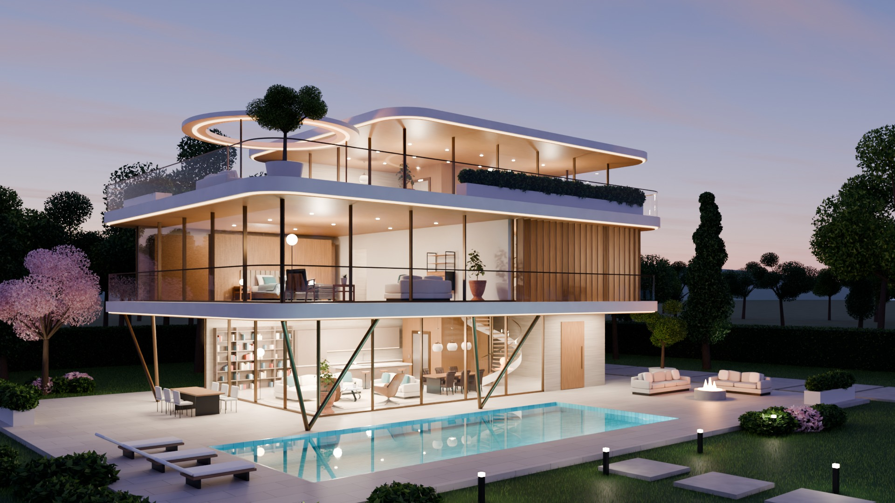

# Orbis House

A fictional three-level futuristic house, built and rendered entirely by script in Blender, with two
plain HTML pages for exploring it. The name, floor areas and price are made up.



## View it

The pages need a local web server, because browsers will not let the walk-through read images straight from disk:

```bash
python -m http.server
```

Then open:

- `http://localhost:8000/index.html` to hover a level and step inside it
- `http://localhost:8000/tour.html` to walk through 20 linked 360° spots (drag to look, click a ring or press W to walk)

## Rebuild it

Needs [Blender](https://www.blender.org/) 5.x and Python 3.

```bash
python fetch_assets.py
blender -b -P render.py
```

`fetch_assets.py` downloads 17 furniture models (82 MB) into `assets/`. `render.py` builds the whole scene and
writes the four stills, `floors.js`, the `tour/` panoramas and `tour.js`. The full set took about 40 minutes on
an RTX 4050. Add `-- --draft` for a quick low-quality pass, or `-- --only=tour-kitchen` to render one view.

## Credits

Furniture models are CC0 from [Poly Haven](https://polyhaven.com). Everything else is generated by `render.py`.
